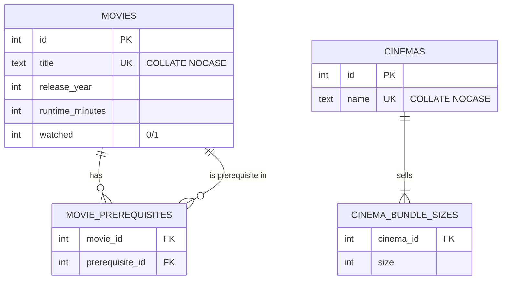

# Doomsday Ready — 60-Minute Implementation Plan

**Stack:** Node + Express + TypeScript · SQLite (better-sqlite3, raw SQL) · React + Vite + React Router · Vitest · Docker Compose
**Split:** **You** hand-write the 3 algorithm functions (the brief requires this for features 1 & 2). **Claude** scaffolds everything else and writes the tests your functions must pass.
**Cut order if late:** Docker Compose first.

---

## 1. Task analysis

| Feature | Real problem | Algorithm | Cost |
|---|---|---|---|
| Circular-dependency check | Prerequisites form a directed graph that must stay acyclic (a DAG) | DFS: setting `prereqs(M) = P` makes a cycle if any `p` in `P` is `M`, or if `M` can be reached from `p` by following prerequisites | O(V+E) |
| Rewatch order | All ancestors of the target, topologically sorted, target excluded | DFS post-order from the target's prerequisites with a `visited` set (each movie appears once) | O(V+E) |
| Booking quote | Unbounded coin change, **fewest coins**, exact sum | DP: `dp[0]=0`, `dp[i] = min(dp[i-b]+1)` over sizes `b`; remember `choice[i]=b`; walk back from `n` to rebuild | ≤ 10,000 × 10 = 100k steps |

Checks against the spec tables:
- `6, 9, 20` / 44 → 20 + 9 + 9 + 6 = **4 bundles** ✓ (a greedy approach gives 20+20 = 40, then fails; this is why DP is needed)
- `4, 6` / 7 → no exact sum → `null` → "Not possible" ✓
- A **new** movie can't create a cycle (nothing depends on it yet). Cycles can only happen on **PATCH** of prerequisites. The check still runs on create, because it costs nothing.

---

## 2. API contract

All routes are under `/api`. Errors use `{ "error": "CODE", "message": "..." }`.

| Method & path | Body / query | Success | Errors |
|---|---|---|---|
| `POST /movies` | `{ title, releaseYear, runtimeMinutes, prerequisiteIds?: number[], watched?: boolean }` | 201 movie | 400 `VALIDATION_ERROR`, 409 `DUPLICATE_TITLE`, 409 `CIRCULAR_DEPENDENCY` |
| `GET /movies` | — | 200 `Movie[]` (with `prerequisiteIds`) | — |
| `PATCH /movies/:id` | any subset of the fields above; `prerequisiteIds` **replaces** the whole list | 200 movie | 400, 404 `NOT_FOUND`, 409 ×2 |
| `GET /movies/:id/rewatch-order` | — | 200 `{ target, movies: Movie[], total, watchedCount, unwatchedRuntimeMinutes }` | 404 |
| `POST /cinemas` | `{ name, bundleSizes: number[] }` | 201 cinema | 400, 409 `DUPLICATE_NAME` |
| `GET /cinemas` | — | 200 `Cinema[]` | — |
| `GET /cinemas/:id/booking?groupSize=N` | `1 ≤ N ≤ 10000` | 200 `{ possible: true, totalBundles, bundles: [{ size, count }] }` or `{ possible: false }` | 400, 404 |

**Validation rules** (put these in the README as assumptions):
- `title` / `name`: trimmed, not empty, unique **case-insensitively**
- `runtimeMinutes`: integer 1–300. `releaseYear`: integer 1900–2100 (the spec doesn't give a range, so this is our choice)
- `prerequisiteIds`: integers that exist, no duplicates, never the movie's own id
- `bundleSizes`: 1–10 **distinct** integers, each 1–500 (duplicates → 400)
- "Not possible" is a normal **200** answer, not an error
- `bundles` sorted by size, largest first (matches the spec's output format). If two answers tie on bundle count, any of them is accepted (note this in the README).

---

## 3. Data model (goes into the README as a Mermaid diagram)



Composite primary keys go on `(movie_id, prerequisite_id)` and `(cinema_id, size)`. `PRAGMA foreign_keys = ON`. Prerequisite updates run inside a transaction: delete the old rows, then insert the new ones.

---

## 4. Repository layout

```
Blinto/
├─ server/
│  ├─ src/
│  │  ├─ index.ts            # express app, /api mount, error handler
│  │  ├─ db.ts               # better-sqlite3 + schema
│  │  ├─ seed.ts             # 8 sample movies + 4 sample cinemas
│  │  ├─ errors.ts           # ApiError(status, code, message)
│  │  ├─ validation.ts       # hand-rolled body checks
│  │  ├─ routes/movies.ts
│  │  ├─ routes/cinemas.ts
│  │  └─ algorithms/         # ← YOU WRITE THESE
│  │     ├─ graph.ts
│  │     └─ booking.ts
│  └─ tests/algorithms.test.ts   # Claude writes these from the spec tables
├─ client/                   # Vite React TS, dev proxy /api → :3000
│  └─ src/{api.ts, App.tsx, pages/Movies.tsx, pages/RewatchPlan.tsx, pages/Booking.tsx}
├─ docker-compose.yml
└─ README.md
```

### The functions you implement (signatures are fixed so the tests and routes fit them)

```ts
// algorithms/graph.ts — graph: movieId -> its prerequisite ids
export type Graph = Map<number, number[]>;
export function wouldCreateCycle(graph: Graph, movieId: number, newPrereqIds: number[]): boolean;
export function rewatchOrder(graph: Graph, targetId: number): number[]; // target excluded, prerequisites before dependents

// algorithms/booking.ts
export function quoteBooking(sizes: number[], groupSize: number):
  { size: number; count: number }[] | null; // null = not possible
```

The routes build the `Graph` from the DB on each request. The data is tiny, so this stays simple.

---

## 5. Minute-by-minute schedule

| Time | Claude | You |
|---|---|---|
| **0–5** | `git init`, scaffold `server/` + `client/`, install deps, empty algorithm stubs, failing tests | Read §1 and the signatures |
| **5–20** | DB schema, seed, errors, validation, movie + cinema routes wired to your functions | Write `wouldCreateCycle` + `rewatchOrder`, run `npm test` |
| **20–28** | curl smoke test of all 7 endpoints against the seed data | Write `quoteBooking`, get all tests green |
| **28–45** | React: router + nav, **Movies** (add form, prerequisite multi-select, watched checkbox, inline 409 messages), **Rewatch Plan** (target select, ordered list with ticks, progress bar "4 of 7 watched", remaining time as `Xh Ym`), **Booking** (cinema select, group size, result, small add-cinema form) | Review the API code and the UI in the browser |
| **45–52** | Docker Compose: `server` (node:22-slim, because better-sqlite3 needs glibc prebuilt binaries) + `client` (build → nginx, proxy `/api`), SQLite volume. **First thing to cut.** | — |
| **52–58** | README: run steps, API table, assumptions (§2), Mermaid diagram, **AI usage section** (honest: Claude scaffolded the API/UI/Docker/tests; you wrote the algorithms) | Write the AI-usage paragraph in your own words |
| **58–60** | Final `npm test` + clean-start check | Push to GitHub, submit the form |

### Tests (the spec's expected results, word for word)
- Doomsday → 7 movies, every movie after its prerequisites (checked by position, not by one fixed order)
- Civil War → `{Iron Man, First Avenger}` in either order, then The Avengers
- Ragnarok → `[]`
- Endgame as a prerequisite of Iron Man → cycle `true`; self-prerequisite → `true`
- Booking: `[1,3,4]/6 → 3×2`, `[2,5]/11 → 5×1, 2×3`, `[6,9,20]/44 → 20×1, 9×2, 6×1`, `[4,6]/7 → null`, plus `groupSize = 10000` stays fast

---

## 6. Risks

- **Running over time on the algorithms** → after 25 minutes on them, check the hints in §1 rather than getting stuck. The tests show exactly which case fails.
- **better-sqlite3 native build** in Docker → use the `node:22-slim` image, not alpine.
- **Tie-breaking in booking** → any minimal answer is valid. Write the rule down in the README.
