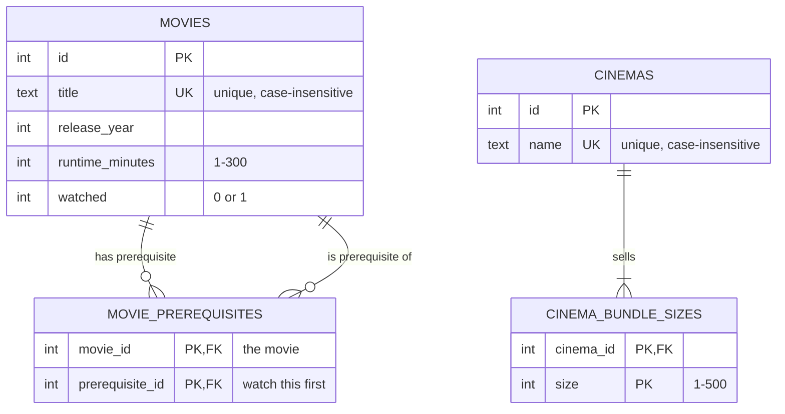

# Doomsday Ready

A small full-stack app that helps MCU fans plan their rewatch before *Avengers: Doomsday* and book an opening-night watch party.

- **Movies & rewatch order:** track movies, what to watch before each one, and what you've seen. Get every movie you need before a target, in an order that works.
- **Watch-party booking:** cinemas sell opening-night seats only in fixed bundles. Get the fewest bundles that seat your group exactly, or find out it can't be done.

**Stack:** Node + Express 5 + TypeScript · SQLite (better-sqlite3) · React 19 + Vite + React Router · Vitest · Docker Compose

---

## Quick start

### With Docker (one command)

```bash
docker compose up --build
```

Open **http://localhost:8080**. On first start the database is seeded with the sample movies and cinemas from the brief. Data is kept in the `db-data` volume; `docker compose down -v` wipes it.

### Without Docker

Needs Node 22 or newer.

```bash
# API on http://localhost:3000/api
cd server
npm install
npm run seed    # load sample data (wipes the DB)
npm run dev
```

```bash
# Web app on http://localhost:5173 (proxies /api to :3000)
cd client
npm install
npm run dev
```

### Tests

```bash
cd server && npm test
```

The tests cover every row of the brief's "Expected Results" tables, plus edge cases: a shared prerequisite listed once, re-saving the same prerequisites, a movie not in the graph yet, unsorted bundle sizes, a group smaller than every bundle, and a speed check at the largest allowed inputs (10 sizes, group of 10,000).

API tests in `server/tests/api.test.ts` start the real Express app against an in-memory SQLite database. They check:

- the rewatch counts;
- that a rejected cycle leaves the data unchanged;
- duplicate names, case-insensitively and including non-ASCII letters;
- the prerequisite cap;
- 400, 413 and 415 responses for bad request bodies.

---

## API

All routes are under `/api`. Errors always look like `{ "error": "CODE", "message": "..." }`. Any endpoint can also return `413 PAYLOAD_TOO_LARGE` for a body over 100 KB.

| Method & path | Body / query | Success | Errors |
|---|---|---|---|
| `POST /movies` | `{ title, releaseYear, runtimeMinutes, prerequisiteIds?, watched? }` | `201` movie | `400 VALIDATION_ERROR`, `409 DUPLICATE_TITLE`, `409 CIRCULAR_DEPENDENCY` |
| `GET /movies` | — | `200` movie list | — |
| `PATCH /movies/:id` | any of the fields above | `200` movie | `400`, `404 NOT_FOUND`, `409 DUPLICATE_TITLE`, `409 CIRCULAR_DEPENDENCY` |
| `GET /movies/:id/rewatch-order` | — | `200` see below | `404` |
| `POST /cinemas` | `{ name, bundleSizes }` | `201` cinema | `400`, `409 DUPLICATE_NAME` |
| `GET /cinemas` | — | `200` cinema list | — |
| `GET /cinemas/:id/booking?groupSize=N` | `N` from 1 to 10,000 | `200` see below | `400`, `404` |
| `GET /health` | — | `200 { ok: true }` | — |

**Movie:** `{ id, title, releaseYear, runtimeMinutes, watched, prerequisiteIds: number[] }`

**Rewatch order:**

```json
{
  "target": { "id": 4, "title": "Captain America: Civil War", "...": "..." },
  "movies": [ { "title": "Iron Man" }, { "title": "Captain America: The First Avenger" }, { "title": "The Avengers" } ],
  "total": 3,
  "watchedCount": 1,
  "unwatchedRuntimeMinutes": 267
}
```

**Booking quote** (for `6, 9, 20` and a group of 44):

```json
{ "possible": true, "totalBundles": 4, "groupSize": 44,
  "bundles": [ { "size": 20, "count": 1 }, { "size": 9, "count": 2 }, { "size": 6, "count": 1 } ],
  "cinema": { "id": 3, "name": "Grand Odeon Hall", "bundleSizes": [6, 9, 20] } }
```

If no exact combination exists, the response is `{ "possible": false, ... }` with status `200`.

### Example

```bash
curl -X PATCH localhost:3000/api/movies/1 \
  -H 'Content-Type: application/json' \
  -d '{"prerequisiteIds":[7]}'
# → 409 {"error":"CIRCULAR_DEPENDENCY", ...}   (Endgame as a prerequisite of Iron Man)
```

---

## Data model



Prerequisites are a many-to-many link from `movies` to itself: each row means "watch `prerequisite_id` before `movie_id`". Together the rows form a directed graph, and the app keeps it free of cycles. Bundle sizes get their own table, so the database itself enforces "distinct sizes, 1–500 each".

---

## How it works

### Feature 1: Rewatch order and cycle check

Movies and their prerequisites form a **directed graph**: an arrow from a movie to each movie you should watch first. The code is in [`server/src/algorithms/graph.ts`](server/src/algorithms/graph.ts).

**Cycle check: `wouldCreateCycle(graph, movieId, newPrereqIds)`**

Giving movie *M* the prerequisites *P* creates a cycle exactly when *M* can be reached from some movie in *P* by following prerequisite arrows. That path plus the new arrow from *M* would form a loop. A movie listed as its own prerequisite is the shortest case.

So the check is a depth-first search that starts from the new prerequisites and returns `true` as soon as it reaches *M*. A visited set means each movie is looked at once: **O(V + E)**. *M*'s current prerequisites don't matter, because they are being replaced, and the search stops the moment it reaches *M*.

A brand-new movie has no id yet and nothing depends on it, so the check can never fire on create. It still runs, which costs nothing.

**Rewatch order: `rewatchOrder(graph, targetId)`**

This is a **topological sort** of everything the target depends on, done with a depth-first search in *post-order*: a movie is added to the list only after all of its own prerequisites have been added. That's exactly the rule "every movie comes after its prerequisites".

- A **visited set** makes each movie appear once, even when several movies share it (Iron Man is needed by The Avengers, which is needed by Civil War, and so on).
- The **target is marked visited from the start**, so it's never in the list.
- The search uses an **explicit stack** instead of recursion, so a very long chain of movies can't overflow the call stack.
- It only touches movies reachable from the target: **O(V + E)** over that part of the graph.

The route then counts the watched movies and adds up the runtimes of the unwatched ones.

The API loads the graph from SQLite and passes it to these functions. Each create or update runs in one transaction, so a rejected change leaves nothing behind.

### Feature 2: Booking quote

Finding the fewest bundles that add up to exactly the group size is the **minimum coin change** problem, with bundle sizes as coins. The code is in [`server/src/algorithms/booking.ts`](server/src/algorithms/booking.ts).

**Why not greedy?** Always taking the biggest bundle that fits gives wrong answers. For sizes `6, 9, 20` and a group of 44, greedy takes 20 + 20 and then can't seat the last 4 people, while the right answer is 20 + 9 + 9 + 6.

**Dynamic programming.** Work out the best answer for every seat count from 0 up to the group size:

```
fewest[0] = 0
fewest[s] = 1 + min(fewest[s - b])   for each bundle size b ≤ s
```

Alongside it, `lastBundle[s]` records which size gave that minimum. Walking back from the group size (subtract `lastBundle[s]`, repeat until 0) and counting gives how many of each size to buy. If `fewest[groupSize]` was never reached, no exact combination exists, and the API answers "not possible".

- **Cost:** O(group size × number of sizes), at most 10,000 × 10 = 100,000 steps. Memory is O(group size). The test suite checks the largest inputs finish well under 200 ms.
- **Ties:** sizes are tried largest first, and only a strictly smaller count replaces the current choice. When several combinations use the same fewest number of bundles, the result is deterministic, and any of them meets the brief.
- **Output:** one line per size used, largest size first, matching the brief's format (`20 × 1, 9 × 2, 6 × 1`).

As the brief requires, both features are written by hand with no graph or optimisation libraries.

---

## Assumptions and choices

The brief left these open, so I made a choice for each:

- **Release year** must be a whole number from 1900 to 2100. The 1–300 range in the brief applies to runtime only.
- **Titles and cinema names** are trimmed and must be unique ignoring case, for any letter, not just A–Z ("iron man" clashes with "Iron Man", and "élan" with "Élan").
- **Prerequisites are referenced by movie id** (`prerequisiteIds`), at most 500 per movie. Unknown ids or duplicates give `400`.
- **Sending `prerequisiteIds` in a PATCH replaces the whole list**; leaving it out keeps the current one.
- **A movie listed as its own prerequisite** returns `409 CIRCULAR_DEPENDENCY` (it's the "directly" case in the brief), not `400`.
- **A new movie can't create a cycle**, because nothing depends on it yet. The check still runs on create, for safety.
- **"Not possible" is a normal `200` answer** (`possible: false`), not an error: the request was valid; there's just no exact fit.
- **Bundle sizes must be distinct.** A duplicate like `[2, 2]` gives `400` instead of being silently merged.
- **Bundles are listed largest size first**, matching the brief's format. If several combinations use the same fewest number of bundles, any one of them is returned.
- **The UI hides a movie from its own prerequisite picker**; the API still guards against it.
- **The UI also lets you add cinemas** (on the Booking page), since the brief has an API for it but no screen.
- **Sample runtimes are approximate**; Doomsday's 150 minutes is a placeholder.
- **No delete endpoints**, as the brief didn't ask for them.

---

## Project structure

```
server/
  src/
    index.ts            Express app, /api router, error handler
    db.ts               SQLite connection and schema
    seed.ts             sample data (npm run seed)
    validation.ts       input checks
    errors.ts           ApiError(status, code, message)
    routes/movies.ts    movie endpoints
    routes/cinemas.ts   cinema endpoints
    algorithms/         feature 1 and 2 logic (hand-written)
  tests/                Vitest tests for the algorithms
client/
  src/
    api.ts              typed fetch wrapper
    pages/              Movies, RewatchPlan, Booking
    components/         PrereqPicker
  nginx.conf            serves the built app and proxies /api (Docker)
docker-compose.yml
```

---

## Credits

This is a fan project, not affiliated with Marvel or Disney. The look is inspired by the Avengers, but it uses no Marvel logos, artwork or other assets. The shield emblem and the favicon are original SVGs.

- **Fonts:** [Bebas Neue](https://fonts.google.com/specimen/Bebas+Neue) and [Inter](https://rsms.me/inter/), both under the SIL Open Font License 1.1. They're bundled through `@fontsource`, so the app makes no external font requests.

---

## How I used AI

I used **Claude Code** (Anthropic) as a coding assistant:

- **Planning:** turned the brief into a time-boxed plan, an API contract and a list of open questions, which I answered.
- **Scaffolding and plumbing:** project setup, the SQLite schema, Express routes, input validation, the React views and styling, the Docker setup and a first draft of this README.
- **Tests:** wrote the Vitest cases from the brief's expected-results tables *before* I wrote the algorithms, so I could check my code against them.

**I wrote the core logic of features 1 and 2 myself**: the cycle check, the rewatch-order sort and the booking calculation in `server/src/algorithms/`. I reviewed and tested all the generated code.
